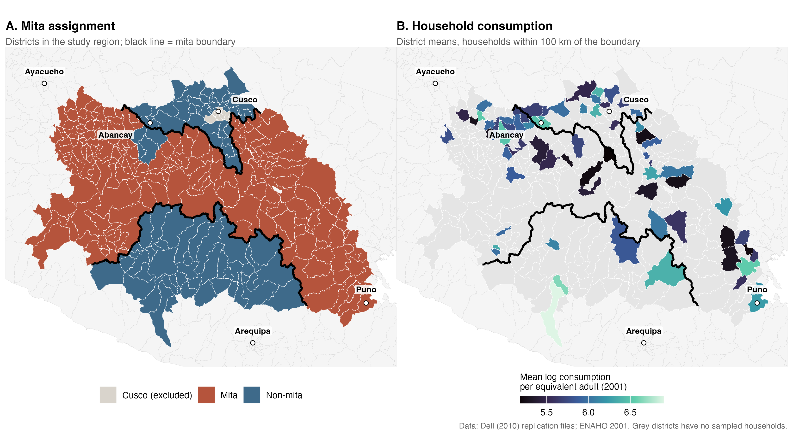
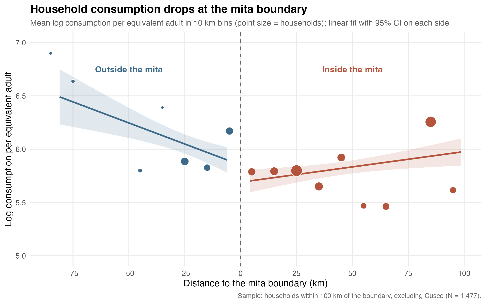

# Replication of Dell (2010), "The Persistent Effects of Peru's Mining *Mita*"

An R replication of the main consumption result in Melissa Dell (2010), *Econometrica* 78(6): 1863–1903. [doi:10.3982/ECTA8121](https://doi.org/10.3982/ECTA8121)

Dell uses a regression discontinuity design along the boundary of the *mita*, a colonial forced mining labor system (1573–1812). She finds that districts subject to the *mita* have about 25% lower household consumption today. The original analysis is in Stata. This repository rebuilds the data cleaning and estimation from the raw survey files in R.

## Results: Table 2, Panel A (log equivalent household consumption, 2001)

| | < 100 km | < 75 km | < 50 km |
|---|---|---|---|
| **Mita effect (this replication)** | −0.282 (0.199) | −0.214 (0.207) | −0.327 (0.219) |
| Mita effect (Dell 2010) | −0.284 (0.198) | −0.216 (0.207) | −0.331 (0.219) |
| Observations (this replication) | 1,477 | 1,160 | 1,012 |
| Observations (Dell 2010) | 1,478 | 1,161 | 1,013 |

Specification: cubic polynomial in latitude and longitude, household demographic controls, elevation, slope, and boundary-segment fixed effects. The sample excludes Cusco. Standard errors are clustered by district.

Coefficients match the original to within 0.004 and standard errors to within 0.001. See *Notes on the replication* below for the one-observation difference.

## Figures

**Figure 1.** Mita assignment and district-level household consumption around the boundary.



**Figure 2.** Regression discontinuity plot: binned means of log household consumption against distance to the mita boundary, with separate linear fits on each side.



The RD plot uses raw binned means without the controls in Table 2, so the visible gap (about 0.2 log points) is a descriptive check, not the estimate.

## How to run

1. **Get the data.** Download the replication package from [Econometrica](https://www.econometricsociety.org/publications/econometrica/2010/11/01/persistent-effects-perus-mining/supp/8121_data_and_programs_0.zip) and unzip it. Move the `.dta` files into `data/raw/`. The raw data (about 1.2 GB) is not included in this repository.
2. **Restore packages.** Open `dell-2010-mita-replication.Rproj` in RStudio and run `renv::restore()`.
3. **Run the scripts in order:**
   - `code/01_clean_consumption.R` builds household consumption per equivalent adult from the 2001 ENAHO survey and merges district geography. It writes `data/clean/consumption.rds`.
   - `code/02_table2.R` estimates Table 2, Panel A and writes `output/tables/table2_panelA.tex`.
   - `code/03_figures.R` draws the boundary map and the RD plot and writes them to `output/figures/`.

## Repository structure

```
code/            R scripts (run in numbered order)
data/raw/        original data (not tracked, see "How to run")
data/clean/      intermediate data built by the scripts (not tracked)
output/tables/   regression tables
output/figures/  maps and RD plot
dell_original/   Dell's original Stata, R and Python code, kept for reference
```

## Notes on the replication

- **One-observation gap.** Each column has one fewer household than the original. The gap is the same in all three columns, so the missing household lies within 50 km of the boundary. Tests so far rule out missing household-relationship codes (`p203`) and households without a head.
- **Negative consumption set to zero.** For 59 of 3,075 households, reported transfers exceed total spending, so consumption net of transfers is negative and its log is undefined. Following the original code (`recode lhhequiv .=0`), these are set to 0 rather than dropped. Because this treats them as extremely poor rather than missing, it is worth testing whether excluding them changes the estimates.
- **Households with two heads.** Three households report two household heads and therefore appear twice in the household-level data. This matches the behavior of the original code.
- **Identifier cleaning.** ENAHO identifiers contain leading spaces. Department codes are recovered by trimming and zero-padding `ubigeo` to six digits.

## To do

- [ ] Table 2, Panels B and C (distance to Potosí and distance to the boundary polynomials)
- [ ] Table 2, child stunting outcome
- [x] RD map figure with `sf`
- [ ] Robustness: exclude the 59 negative-consumption households

## Reference

Dell, Melissa. 2010. "The Persistent Effects of Peru's Mining *Mita*." *Econometrica* 78 (6): 1863–1903.

---
*Replication by Jonathan Neuhaus.*
